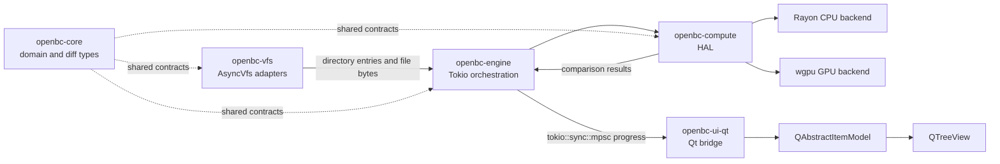

# OpenBC Architecture

OpenBC is a native comparison application organized as a dependency-directed Cargo workspace. UI concerns stay at the edge; domain, transport, and compute layers remain independently testable.

## Data flow

## Crate responsibilities

- `openbc-core`: dependency-light models, comparison policy, result types, and pure diff algorithms.
- `openbc-vfs`: `AsyncVfs`, metadata, directory streams, and local/remote adapters. Adapters must expose lazy directory levels.
- `openbc-compute`: execution policy and backends. It chooses CPU or GPU without leaking backend types to callers.
- `openbc-engine`: bounded Tokio pipelines. It requests directory levels progressively, performs metadata comparison first, then schedules phase-two content work.
- `openbc-ui-qt`: Qt event-loop integration and virtualized model state. It consumes progress messages and never performs scans itself.

## Thread safety and scheduling

1. Qt model methods run only on the Qt GUI thread.
2. Tokio tasks may perform asynchronous I/O and channel coordination, but never CPU-heavy hashing or synchronous blocking calls.
3. Rayon owns CPU-bound work. Configure its pool explicitly when embedding OpenBC so it cannot oversubscribe the host.
4. GPU submission happens through the compute backend and returns results to the engine. No GPU object crosses into the UI crate.
5. `ScanEvent` values are owned, serializable messages. The UI receives them through a bounded `tokio::sync::mpsc` bridge.
6. Backpressure is intentional: a full progress channel pauses producers rather than allowing unbounded memory growth.

## Performance policy

- Directory traversal is lazy and level-by-level: each completed level reveals its children and queues their levels under bounded concurrency until the full tree is compared. Expansion controls visibility, not whether descendants are compared; never perform an upfront recursive scan.
- Metadata comparison (size and modified time) precedes content comparison.
- Small and medium files use the Rayon backend. The default GPU eligibility threshold is 4 MiB; files below 1 MiB must never be sent to a GPU.
- GPU transfers are chunked and bounded. A future implementation should use pinned or staging buffers and avoid mapping a file larger than the configured memory budget.
- Memory mapping is an optimization, not a correctness requirement. Do not map remote files or unbounded files; stream them through bounded buffers.
- If no compatible adapter is available, initialization fails into the CPU backend without affecting scan correctness.
- Hash algorithm selection belongs to core policy; backend implementations must return equivalent results for the same input.

## Image compare

Image compare (Picture Compare tab) follows the same layering as folder compare:

- `openbc-core::image_compare`: `RgbaImage`, `ImageCompareOptions` (mode, tolerance, range, blend, offset, resize policy), `ImageCompareOutput`, 9x9 `PixelProbe`, and the reference integer-only `PixelRenderer`. All backends must be bit-exact with it.
- `openbc-compute::image`: decode, bilinear resize and compare on Rayon; a GPU executor trait and WGSL kernel for canvases at or above the GPU threshold (never below 1 MiB), with automatic CPU fallback. Work is cancelled cooperatively, per row.
- `openbc-engine::image_compare`: one actor per tab. File bytes come through `ImageByteSource` (local FS today, `AsyncVfs` adapters later), decode/compare run on Rayon, and `ImageCompareEvent`s flow to the UI over a bounded `tokio::sync::mpsc` channel. Option changes (tolerance, mode, offset, ...) travel on a latest-wins `watch` channel and re-run only the compare phase, superseding any in-flight pass.
- `openbc-ui-qt`: a C ABI (`image_compare_ffi.rs`) with a callback that runs on a Rust worker thread; the Qt tab copies the event and re-posts it to the GUI thread. The 9x9 hover probe is a synchronous read of the newest finished compare and never touches the pipeline.

Memory is bounded: the event channel holds at most four events (each can carry a canvas-sized overlay), and files above `ImageCompareConfig::max_file_bytes` or decoders above `MAX_DECODE_ALLOC` are rejected per path without affecting the other side.

## Audio spectral compare

- `openbc-compute::audio_compare` decodes audio to normalized interleaved PCM; `openbc-compute::spectral_diff` applies a Hann-windowed, radix-2 STFT and converts aligned magnitudes into a bounded-width RGB888 image. Channel power is averaged across each track's channels, and the longer duration defines the timeline.
- The composite uses neutral gray for matching magnitudes, magenta for excess energy in A, and cyan for excess energy in B. Frequency runs from DC at the bottom to Nyquist at the top.
- `openbc-ui-qt::AudioSpectralDiffWidget` copies the RGB buffer into a `QImage` and paints only the source rectangle for the visible time viewport. Its playhead and viewport callbacks allow the host to synchronize both players and other timeline views without work on a background thread touching Qt state.

## Failure model

VFS failures are attached to the affected path and emitted as scan events. A single unreadable file must not terminate unrelated sibling work. Fatal configuration and channel-closure errors terminate the scan with an explicit error.
