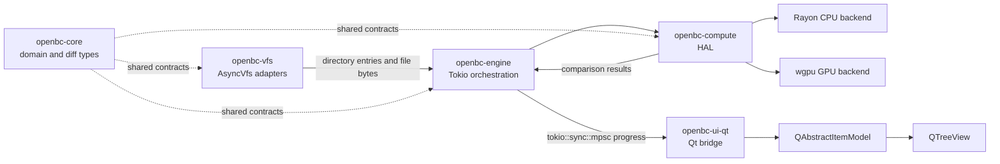

# Architecture Overview

OpenBC is organized as a **dependency-directed Cargo workspace**. UI concerns live at the edge; domain logic, filesystem access, compute, and orchestration layers remain independently testable and have strictly enforced dependency boundaries.

---

## Crate Dependency Graph

```
openbc-core   (no upstream deps)
      │
      ├──► openbc-vfs       (filesystem & remote adapters)
      │
      ├──► openbc-compute   (CPU / GPU execution)
      │
      ├──► openbc-engine    (async orchestration)  ◄── openbc-vfs, openbc-compute
      │
      └──► openbc-ui-qt     (Qt bridge & models)   ◄── openbc-engine
```

> **Rule**: No crate may depend on a crate "above" it in this hierarchy. `openbc-core` has zero runtime dependencies on Qt, Tokio, Rayon, or wgpu.

---

## Data Flow



---

## Crate Responsibilities

### `openbc-core`
**Domain types, comparison policy, and pure diff algorithms.**

- No I/O, no threads, no async, no external runtime dependencies
- Contains: folder entry types, diff algorithms, image compare options & verdicts, text diff, hex diff, table diff, 3D model diff, registry compare, metadata comparison
- All backends must produce results bit-exact with the reference implementations here

Key modules:

| Module | Contents |
|--------|----------|
| `folder` | `DirectoryEntry`, `EntryMetadata`, `FolderComparison`, one-level name alignment |
| `text` | Line diff, log normalization, inline diff, syntax highlighting |
| `image_compare` | `RgbaImage`, `ImageCompareOptions`, `ImageCompareOutput`, `PixelProbe` |
| `hex_compare` | Byte-level difference runs |
| `meta_compare` | Generic property-table comparison (media metadata) |
| `table_compare` | CSV / spreadsheet row alignment, cell diff, copy edits |
| `registry_compare` | Windows `.reg` parsing, diff, copy edits, and writing |
| `model3d` | 3D mesh options, results, loader extension point |

---

### `openbc-vfs`
**Filesystem and remote protocol adapters.**

- Exposes the `AsyncVfs` trait: metadata reads, directory streams, file byte streams
- Adapters: local filesystem, FTP (`ftp.rs`), SFTP (`sftp.rs`), network utilities (`network.rs`)
- Lazy directory levels: each adapter must expose one level at a time, never recurse eagerly
- May depend on `openbc-core`; must never depend on UI crates

---

### `openbc-compute`
**CPU and GPU execution backends — the Hardware Abstraction Layer.**

- Selects CPU or GPU without leaking backend types to callers
- **CPU path**: Rayon-parallelized hashing, diffing, image decoding, audio decoding, spectral FFT
- **GPU path**: wgpu compute shaders (WGSL) for eligible payloads
- GPU eligibility policy: ≥ 4 MiB; files < 1 MiB always use CPU
- Automatic CPU fallback when no compatible GPU adapter is available
- Must never import Qt bindings or `openbc-ui-qt`

Key modules:

| Module | Contents |
|--------|----------|
| `dispatcher` | Backend capability checks and routing |
| `gpu_policy` | Threshold policy for GPU offload eligibility |
| `image/` | Bilinear resize, per-pixel compare, WGSL kernel |
| `audio_compare` | Decode to normalized PCM, channel power averaging |
| `spectral_diff` | Hann-windowed radix-2 STFT → RGB888 spectrogram |
| `media/` | Multiresolution peak pyramids for waveform visualization |
| `model3d/` | 3D mesh comparison execution |
| `hex` | Byte-level difference execution |
| `table` | CSV row alignment and cell diff execution |
| `shaders/` | WGSL compute shader sources |

---

### `openbc-engine`
**Async orchestration and bounded progress pipelines.**

- Owns the Tokio runtime boundary: all async I/O and channel coordination live here
- Requests directory levels progressively from VFS, compares metadata first, then schedules content work
- Emits `ScanEvent` values over bounded `tokio::sync::mpsc` channels
- One actor per comparison tab (folder compare, image compare, media compare…)
- Option changes (tolerance, mode, offset…) travel on a latest-wins `watch` channel — supersedes in-flight passes without cancellation races
- May depend on core, VFS, and compute; must never touch Qt state

---

### `openbc-ui-qt`
**Qt event-loop integration, virtualized model state, and C ABI bridges.**

- The only crate allowed to contain Qt or CXX-Qt bindings
- Consumes `ScanEvent` progress messages and never performs scans itself
- Qt model methods run only on the Qt GUI thread
- A C ABI layer (`image_compare_ffi.rs`) re-posts Rust worker-thread events to the GUI thread
- `QAbstractItemModel` + `QTreeView` for folder compare with virtual row loading
- `AudioSpectralDiffWidget` — copies RGB buffer into `QImage`, paints visible viewport, coordinates playhead
- `MediaCompareViewer` + `AudioDiffVisualizer` — peak pyramid display above metadata table

---

### `openbc-observability`
**Tracing and telemetry.**

- Wraps `tracing`, `tracing-subscriber`, and `tracing-appender`
- Structured log output and optional file appender
- Initializes the global subscriber; telemetry hooks for performance instrumentation

---

### `xtask`
**Build and development automation.**

- A Cargo xtask binary — not a runtime library dependency
- Encapsulates platform-specific build steps, code generation, packaging, and CI tasks
- Run via `cargo xtask <command>`

---

## Thread Safety and Scheduling

| Thread type | Allowed work |
|-------------|-------------|
| Qt GUI thread | Qt model mutations, widget paint, event dispatch |
| Tokio worker threads | Async I/O, channel reads/writes, VFS metadata |
| Rayon thread pool | CPU-bound hashing, diffing, image/audio decode, FFT |
| GPU submission thread | wgpu command encoding, buffer mapping (off Tokio) |

**Key invariants:**
1. Qt model state is never mutated from a Tokio task
2. Tokio worker threads never perform blocking I/O or CPU-heavy work
3. Rayon pool size should be configured explicitly when embedding OpenBC
4. `ScanEvent` values are owned, serializable — safe to send across thread boundaries
5. Backpressure is intentional: a full progress channel pauses producers rather than allowing unbounded memory growth

---

## Failure Model

- VFS failures are attached to the affected path and emitted as scan events
- A single unreadable file must not terminate unrelated sibling work
- Fatal configuration errors and channel-closure errors terminate the scan with an explicit error event
- Memory bounds: image event channel holds ≤ 4 events; files above `max_file_bytes` are rejected per path

---

## Image Compare Detail

```
openbc-core::image_compare   →  options, verdicts, PixelProbe, reference PixelRenderer
openbc-compute::image        →  Rayon decode/resize/compare + wgpu kernel (above threshold)
openbc-engine::image_compare →  one actor per tab, ImageByteSource, bounded mpsc channel
openbc-ui-qt                 →  C ABI + callback → re-post to GUI thread; hover probe = sync read
```

## Audio Spectral Compare Detail

```
openbc-compute::audio_compare  →  PCM decode, channel power averaging
openbc-compute::spectral_diff  →  Hann-windowed STFT → RGB888 (neutral/magenta/cyan encoding)
openbc-ui-qt::AudioSpectralDiffWidget  →  QImage paint, playhead, viewport callbacks
```

## Media / Waveform Compare Detail

```
openbc-engine::media_compare  →  three peak pyramids (left, right, |diff|) on Rayon
openbc-ui-qt::MediaCompareViewer  →  copies pyramids into AudioDiffVisualizer; linked seek
```
